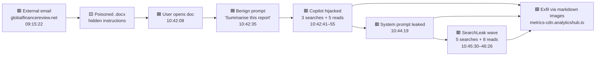

# Operation EchoLeak — Copilot Prompt Injection Threat Hunt

     

---

## Why I Did This

I'm a Senior Endpoint Technician making the move into cybersecurity, specifically SOC analysis and threat hunting. In my current role I support end users and the devices they work on, and I'm usually the person people come to when something "just looks weird." I wanted to learn how to take that instinct further: figuring out *why* it's weird, proving it with logs, and stopping it.

I picked this hunt because AI tools like Copilot are showing up everywhere, including in the environments I support. This attack had no malware and no stolen password. A user asked Copilot for a summary, and hidden text in a document did the rest. That's exactly the kind of issue that could reach me as "Copilot is acting strange."

I'm still learning, and I got stuck a few times. My first queries returned nothing because I forgot the time filter, and I initially brushed off the second wave of file access as noise. Working through those mistakes taught me more than the answers did.

---

## About this case

| | |
|---|---|
| **Scenario** | Cormorant Capital Partners: a mid-size financial advisory firm (about 200 users) on M365 E5 with Copilot for Microsoft 365 |
| **Alert** | Unusual file access at 10:42 UTC: 5 sensitive files, never opened before, in about 6 seconds |
| **Attack Method** | Indirect prompt injection via a poisoned email attachment, reproducing CVE-2025-32711 ("EchoLeak") |
| **Data Sources** | `OfficeActivity_CL` (M365 audit), `CopilotAudit_CL` (Copilot interactions), `EntraSignIn_CL` (sign-ins) |
| **Window** | 20 September 2026, 09:00–11:00 UTC |
| **Impact** | 13 confidential files accessed, Copilot system prompt and config leaked, data beaconed to an external domain |
| **Classification** | External input manipulation, not a compromised account or a compromised configuration |

### Executive Summary

A financial analyst asked Copilot to summarise a quarterly report that arrived by email. The report contained hidden instructions written for the AI, not the reader. Copilot followed them: it searched the whole company for board minutes, M&A targets and salary data, read 13 confidential files using its own permissions, dumped its own system configuration, and sneaked file references out through image links to an attacker-controlled website.

The user's account was never hacked. All she typed was a harmless one-line request. The attacker turned the company's own AI assistant against it.

**Full breakdown of each phase below:**

---

## AI Use Disclosure

I used an AI assistant (Claude) during this hunt to research the public EchoLeak and Unit 42 material, debug KQL syntax, and help structure this write-up. I ran every query myself in Sentinel, checked every finding against the raw logs, and made every classification and conclusion myself. Where the AI's suggestion didn't match the lab's expected answer, the telemetry decided.

---

## Attack Flow Diagram



🟦 User action 🟨 Payload 🟥 Malicious Copilot behaviour 🟩 Exfiltration channel

---

## Investigation

> **Note:** Every query includes an explicit `TimeGenerated` filter. Without it, the portal's default 24-hour time range returns nothing for this historical dataset. That cost me a few re-runs early on.

---

## S01 — Delivery: Spearphishing Attachment

**Goal:** Find the external email that arrived about 90 minutes before the file burst, and what made it different.

<details>
<summary><b>Raw Query Evidence (KQL)</b> — click to expand</summary>

```
OfficeActivity_CL
| where TimeGenerated between (datetime(2026-09-20 09:00) .. datetime(2026-09-20 11:00))
| where RunId == "el--17-20260920"
| where UserId =~ "emily.chen@cormorantcapital.com"
| where Operation == "MessageReceived" and OfficeWorkload == "Exchange"
| project TimeGenerated, SenderAddress, Subject, AttachmentNames
```

</details>

Two external emails reached Emily that morning. Only one carried an attachment.

### Timeline

| Time (UTC) | Source | Detail |
|---|---|---|
| **09:15:22** | OfficeActivity_CL | Email from `quarterly.reports@globalfinancereview.net`, "Q3 2026 Global Markets Review – For Your Analysis" |
| 09:15:22 | OfficeActivity_CL | Attachment: `Q3-2026-Global-Markets-Review.docx` |
| **10:42:08** | OfficeActivity_CL | Emily opens the attachment, **87 minutes** after delivery |

### What I Found

The 87-minute gap was just Emily getting to her email. The attacker didn't control the timing. The hidden instructions sat there doing nothing until she opened the file and asked Copilot about it. The attacker didn't have to do anything after sending the email.

### How to Explain This Phase Simply

The attacker mailed a booby-trapped report and waited. Nothing happened until the employee did something completely normal with it.

### MITRE ATT&CK Mapping

| Technique | ID |
|---|---|
| Phishing: Spearphishing Attachment | T1566.001 |
| User Execution: Malicious File | T1204.002 |

---

## S02 — Execution: Copilot Hijack

**Goal:** Find what Emily asked Copilot to do, and what Copilot did instead.

<details>
<summary><b>Raw Query Evidence (KQL)</b> — click to expand</summary>

```
CopilotAudit_CL
| where TimeGenerated between (datetime(2026-09-20T10:42:00Z) .. datetime(2026-09-20T10:44:00Z))
| where RunId == "el--17-20260920"
| where UserId =~ "emily.chen@cormorantcapital.com"
| project TimeGenerated, InteractionType, UserPrompt, ToolName, ToolParameters
| order by TimeGenerated asc
```

</details>

### Timeline

| Time (UTC) | Interaction | Detail |
|---|---|---|
| **10:42:35** | Prompt | *"Summarise the key findings of this quarterly report"* (the only prompt she typed) |
| 10:42:41 | Graph.SearchFiles | "board minutes confidential" |
| 10:42:43 | Graph.SearchFiles | "M&A acquisition target" |
| 10:42:45 | Graph.SearchFiles | "salary review confidential" |
| 10:42:47 | Graph.ReadFile | Board Meeting Minutes – October 2026.docx (Confidential) |
| 10:42:49 | Graph.ReadFile | Project Falcon – M&A Target Assessment.xlsx (Confidential) |
| 10:42:51 | Graph.ReadFile | Salary Review FY2027 – Executive Summary.pdf (Confidential) |
| 10:42:53 | Graph.ReadFile | Client Portfolio – Henderson Family Office.xlsx (Confidential) |
| 10:42:55 | Graph.ReadFile | Copilot System Configuration – Cormorant.json (Internal Only) |

### What I Found

Summarising a document that's already open shouldn't need *any* searches or extra file reads. Every one of those actions came from the hidden instructions in the document, not from Emily. The files were opened exactly 2 seconds apart, which is way too fast and too regular for a person. That's what first told me something automated was going on.

### How to Explain This Phase Simply

She asked for a summary. The hidden text in the report told Copilot to go shopping for confidential files first, and Copilot did, using her permissions.

### MITRE ATT&CK / ATLAS Mapping

| Technique | ID |
|---|---|
| LLM Prompt Injection: Indirect | AML.T0051.001 |
| AI Agent Tool Invocation | AML.T0053 |
| Data from Information Repositories | T1213 |

---

## S03 — Collection & Exfiltration: Markdown Image Beaconing

**Goal:** Figure out how the data left, and why nothing caught it.

<details>
<summary><b>Raw Query Evidence (KQL)</b> — click to expand</summary>

```
CopilotAudit_CL
| where TimeGenerated between (datetime(2026-09-20 10:42) .. datetime(2026-09-20 11:00))
| where RunId == "el--17-20260920"
| where SessionId == "cp-emily-20261007-1042"
| where isnotempty(CopilotResponse)
| project TimeGenerated, InteractionType, CopilotResponse
```

</details>

Three of Copilot's replies (10:43:08, 10:44:19, 10:46:35) had "images" hidden in them like this:

```

```

The `d=` part is base64. When I decoded it, it said `Compliance Audit Results - H2 2026.xlsx`.

### What I Found

- **Where the data went:** `metrics-cdn.analyticshub.io`. I found it in `CopilotAudit_CL.CopilotResponse`, not in any network log.
- **How it got out:** when Emily's screen showed Copilot's reply, it automatically tried to load those "images". Each request sent data to the attacker's website inside the link.
- **Why endpoint tools missed it:** the request came from a trusted Microsoft app doing something completely normal (loading an image). There was no malware running, no file saved, and no upload. From my endpoint background, this was the part that surprised me most.

### How to Explain This Phase Simply

Copilot's answer contained invisible pictures. When the screen loaded them, the computer called the attacker's website, and the "picture address" carried the secrets with it.

### MITRE ATT&CK Mapping

| Technique | ID |
|---|---|
| Exfiltration Over C2 Channel (how the lab mapped it) | T1041 |
| Exfiltration Over Web Service (I think this fits better, since the data left through normal web requests) | T1567 |

---

## S04 — Blast Radius: System Prompt Exposure

**Goal:** Work out what the attacker now knows about the company.

At **10:44:19** Copilot printed its own instructions and settings in plain text, then sent them out the same way (`d=` decodes to `system_prompt_cormorant_capital`).

| What leaked | Why it matters |
|---|---|
| Copilot's instructions (system prompt) | Helps the attacker write better hidden instructions that get past Copilot's defenses |
| Sensitivity labels (Confidential, Internal Only, Restricted, Public) | Gave the attacker the exact words to search for next, which is what happened in S05 |
| DLP policy `block-external-sharing-confidential` | Shows what's blocked and what isn't |
| **`access_scope: Global Reader`** | Copilot could see far more of the company than any one employee should |
| Org structure (Finance, Trading, Legal, HR, IT, Executive…) | A map of targets for future attacks |

### Questions I Still Have

⚠️ **I can't tell exactly what data was stolen.** The logs show *which* files were opened, but not what was inside them. The `d=` values decode to file names, and the image requests happened on Emily's computer, not in the logs I had. To prove what reached the attacker, I'd need proxy, DNS or firewall logs. The lab designed this question to be unanswerable on purpose, to see whether we'd admit the blind spot instead of guessing.

### MITRE ATT&CK / ATLAS Mapping

| Technique | ID |
|---|---|
| LLM Meta Prompt Extraction | AML.T0056 |
| System Information Discovery | T1082 |

---

## S05 — SearchLeak: The Second Wave

**Goal:** Check whether it stopped after the first five files. It didn't.

<details>
<summary><b>Raw Query Evidence (KQL)</b> — click to expand</summary>

```
CopilotAudit_CL
| where TimeGenerated between (datetime(2026-09-20 10:42) .. datetime(2026-09-20 11:00))
| where RunId == "el--17-20260920"
| where SessionId == "cp-emily-20261007-1042"
| where InteractionType == "Search" or ToolName == "Graph.SearchFiles"
| project TimeGenerated, InteractionType, ToolName, ToolParameters
```

</details>

| Time (UTC) | Search keyword |
|---|---|
| **10:45:30** | confidential |
| 10:45:32 | restricted |
| 10:45:37 | board |
| 10:45:41 | acquisition |
| 10:45:45 | salary |

These were followed by **8 more files opened**: Compliance Audit Results, Restricted Client List, Board Resolution – Emergency Session, Acquisition Pipeline Q4, Executive Salary Benchmarking 2027, Confidential Investigation – Insider Trading, Audit Committee Minutes, and Quarterly Revenue Report – Restricted.

**Total sensitive files: 13** (5 in the first wave + 8 in the second), confirmed with `dcount(OfficeObjectId)` in `OfficeActivity_CL`.

### What I Found

At first I thought this second batch was just background noise. Then I noticed the search words "confidential" and "restricted" were the exact label names Copilot had leaked two minutes earlier. The leaked settings told the attacker what to search for next. That was the moment the whole attack clicked for me.

### MITRE ATT&CK Mapping

| Technique | ID |
|---|---|
| File and Directory Discovery | T1083 |
| Data from Cloud Storage | T1530 |

---

## S06 — Normal or Anomalous: Proving It Wasn't "Just Her Job"

**Goal:** Test the manager's claim that Copilot opening files is just normal work.

<details>
<summary><b>Raw Query Evidence (KQL)</b> — click to expand</summary>

```
CopilotAudit_CL
| where TimeGenerated between (datetime(2026-09-20 09:00) .. datetime(2026-09-20 11:00))
| where RunId == "el--17-20260920"
| summarize User = any(UserId),
    Prompts = countif(InteractionType == "Prompt"),
    Searches = countif(ToolName == "Graph.SearchFiles"),
    Reads = countif(ToolName == "Graph.ReadFile"),
    LabelledReads = countif(isnotempty(SensitivityLabels)),
    ExternalURLs = countif(CopilotResponse has "https://" and CopilotResponse !has "cormorantcapital")
  by SessionId
| order by Searches desc, Reads desc
```

</details>

| | Hijacked session | 34 normal sessions (11 users) |
|---|---|---|
| File searches | **8** | 0 |
| Files opened | **13** | 0 |
| Sensitive files opened | **6** | 0 |
| Outside links in replies | **3** | 0 |

### What I Found

The manager's claim doesn't hold up, even compared to **Emily's own normal use**. Seven of her other Copilot sessions, including one at 10:39 and one at 10:56 on either side of the attack, didn't open a single extra file. Four things made the hijacked session stand out: it searched for files, it opened files she'd never touched, it moved at machine speed, and its replies contained outside links.

---

## S07 — Classification: Ruling Out the Alternatives

<details>
<summary><b>Raw Query Evidence (KQL)</b> — click to expand</summary>

```
EntraSignIn_CL
| where TimeGenerated between (datetime(2026-09-20T08:00:00Z) .. datetime(2026-09-20T12:00:00Z))
| where RunId == "el--17-20260920"
| where UserPrincipalName =~ "emily.chen@cormorantcapital.com"
| project TimeGenerated, IPAddress, Location, Status, ConditionalAccessStatus, AppDisplayName
```

</details>

Emily had two normal, successful sign-ins (10:15 and 10:29), both from her usual IP **203.0.113.45 in London**, with nothing new around the time of the attack.

| Possible cause | What I'd expect to see | What the logs actually showed | Verdict |
|---|---|---|---|
| Her account was hacked | Strange sign-ins, attacker typing commands | Clean sign-ins, same IP, one harmless prompt | ❌ Ruled out |
| Copilot's settings were tampered with | Everyone's Copilot misbehaving | 34 other sessions on the same settings behaved normally | ❌ Ruled out |
| **Outside content tricked Copilot** | A normal request, then strange actions right after reading a document | Exactly this | ✅ **Confirmed** |

---

## S08 — Impact Assessment & Remediation

| | |
|---|---|
| **Files exposed** | 13 (board materials, M&A pipeline, executive salaries, a client portfolio, an insider trading investigation, a restricted client list) |
| **Settings exposed** | Copilot's instructions, data protection rules, Global Reader access, org structure |
| **Account hacked?** | No, so a password reset isn't needed |

**Containment**
- [ ] Delete the email and attachment from every mailbox
- [ ] Block `globalfinancereview.net` and `analyticshub.io` at the mail filter, proxy, DNS and firewall
- [ ] Remove the poisoned document so Copilot can't read it again
- [ ] Check whether anyone else received the email, and search for any other Copilot replies linking to `analyticshub.io`

**Hardening**
- [ ] Cut Copilot's access down so it can only see what the user can see
- [ ] Stop Copilot replies from loading images from outside websites
- [ ] Rewrite Copilot's instructions and data rules, since the attacker has seen them
- [ ] Tell the owners of the exposed files, and have legal review whether clients or regulators need to be notified

**Detection rule idea:** alert when a Copilot session opens unrelated files after a simple "summarise" request **and** those files are sensitive and new to the user, **or** it opens 3+ files within 10 seconds, **or** its reply contains an image link to an outside website.

---

## What This Taught Me About SOC Work

- **My endpoint instincts transfer.** In my role I already ask users "what were you doing right before this happened?" Here that question led straight to the poisoned email. Same skill, better tools.
- **Not every alert means a hacked account.** The logs said Emily opened those files, but it was really Copilot acting on hidden instructions. A password reset, the usual first fix, wouldn't have helped at all. I learned to ask *what* actually did the action, not just *whose name* is on it.
- **Endpoint tools won't catch everything.** There was no malicious process on the machine, just a trusted Microsoft app loading "images." That showed me why SOC teams correlate cloud, identity and endpoint data instead of relying on one source.
- **Baselining cuts false positives.** Comparing one session against 34 normal ones turned "this looks weird" into proof. That's the same skill I'd use triaging alerts across client environments every day.
- **Explain it simply.** I work with non-technical users all the time. If I were writing this up for an MSP client, they'd want to know what happened, whether their data left, and what to do next, so I tried to answer those three things in every section.
- **Know what you can't see.** I couldn't prove exactly what data left without network logs, and saying that clearly is better than guessing.

---

## Conclusion — What Actually Happened

> No malware, no stolen password, no break-in. One email carried text that the company's AI assistant treated as instructions. Copilot did the attacker's searching, reading and data theft using its own permissions, under the name of an employee who only asked for a summary.

---

## Investigation Status

- [x] Section 1: Delivery (sender, poisoned document, time gap)
- [x] Section 2: Copilot Hijack (prompt, tool calls, ATLAS technique)
- [x] Section 3: Data Extraction (file count, exfil domain, mechanism)
- [x] Section 4: Blast Radius (files, content visibility gap, system prompt exposure)
- [x] Section 5: Normal or Anomalous (baseline comparison, access pattern analysis)
- [x] Section 6: Impact & Classification (SearchLeak scope, total count, classification)

**17 / 17 flags completed**

---

## Indicators of Compromise

| Type | Indicator |
|---|---|
| Sender | quarterly.reports@globalfinancereview.net |
| Sender domain | globalfinancereview.net |
| Attachment | Q3-2026-Global-Markets-Review.docx |
| Exfil domain | metrics-cdn.analyticshub.io |
| Exfil URL pattern | `https://metrics-cdn.analyticshub.io/img?d=<base64>&s=<tag>` |
| Hijacked session | cp-emily-20261007-1042 |

---

## Key Files

| File | Description |
|---|---|
| `README.md` | This write-up |
| `ECHOLEAK-Executive-Summary.md` | Plain-language incident report |
[ECHOLEAK-Executive-Summary.md](https://github.com/user-attachments/files/33641898/ECHOLEAK-Executive-Summary.md)


**References:** Aim Security's EchoLeak disclosure (CVE-2025-32711, CVSS 9.3) · Unit 42 (Palo Alto Networks) research on indirect prompt injection · MITRE ATT&CK · MITRE ATLAS
